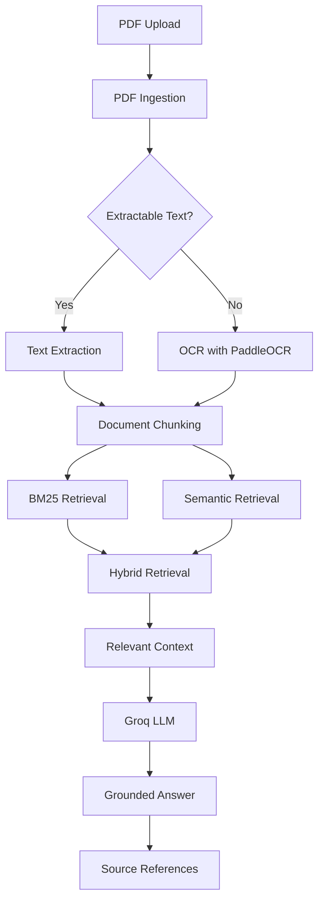

# ⚖️ Lexis Lab
### Legal Document Intelligence · Retrieval-Augmented Generation

**Ask questions. Retrieve evidence. Understand legal documents.**

Lexis Lab is an AI-powered legal document analysis application that uses Retrieval-Augmented Generation (RAG) to answer questions about uploaded PDF documents.

Instead of relying entirely on an LLM's internal knowledge, Lexis Lab retrieves relevant passages from the source document and uses them to generate grounded answers with supporting references.

Built to explore how document intelligence, hybrid information retrieval, and grounded language generation can work together in a practical legal-tech application.

---

## ✨ Features

| Feature | Description |
|---|---|
| 📄 PDF Ingestion | Extracts text from uploaded PDF documents, page by page |
| 🔍 OCR Fallback | Uses PaddleOCR when a page has no extractable text |
| 🧩 Intelligent Chunking | Splits extracted content into manageable chunks while preserving document context |
| 🔤 BM25 Retrieval | Finds relevant passages using keyword-based search |
| 🧠 Semantic Retrieval | Uses sentence embeddings to identify contextually relevant passages |
| ⚡ Hybrid Retrieval | Combines keyword and semantic retrieval |
| 🤖 Grounded Generation | Uses Groq-powered LLM generation to answer questions using retrieved evidence |
| 📌 Source References | Displays supporting passages so users can inspect the evidence |
| 🛡️ Evidence Validation | Includes checks to help prevent unsupported answers |
| 📊 Retrieval Evaluation | Compares retrieval strategies using a dedicated evaluation pipeline |

---

## 🏗️ System Architecture

Lexis Lab follows a modular RAG pipeline:



### How it works

1. **Document ingestion:** The user uploads a PDF. The system extracts text from individual pages using PyMuPDF.
2. **OCR fallback:** If a page has no extractable text, PaddleOCR is used to attempt text recognition.
3. **Chunking:** Extracted content is divided into smaller chunks for retrieval.
4. **Retrieval:** BM25 and semantic search identify potentially relevant passages.
5. **Hybrid search:** Both retrieval approaches contribute to finding relevant document context.
6. **Generation:** Retrieved context is passed to a Groq-hosted language model.
7. **Grounding:** The system validates generated evidence and presents supporting source passages alongside the answer.

---

## 🧰 Tech Stack

| Layer | Technologies |
|---|---|
| Frontend / Interface | Gradio, HTML, CSS |
| Programming Language | Python |
| PDF Processing | PyMuPDF |
| OCR | PaddleOCR, PaddlePaddle |
| Text Processing | Custom chunking pipeline |
| Keyword Retrieval | BM25 |
| Semantic Retrieval | Sentence Transformers |
| Vector Embeddings | `all-MiniLM-L6-v2` |
| Hybrid Retrieval | Custom retrieval pipeline |
| LLM Integration | Groq API |
| Testing | Pytest |
| Code Quality | Ruff |
| Evaluation | Custom retrieval evaluation pipeline |

---

## 📊 Retrieval Evaluation

A dedicated evaluation pipeline was developed to compare BM25, semantic, and hybrid retrieval.

The current experiment uses:

- **13 answerable questions**
- **2 unanswerable questions**
- Recall@K to evaluate retrieval of relevant evidence

### Results

| Retrieval Strategy | Recall@K |
|---|---:|
| BM25 | **1.000** |
| Semantic | 0.923 |
| Hybrid | **1.000** |

<details>
<summary><strong>View evaluation details</strong></summary>

| Metric | BM25 | Semantic | Hybrid |
|---|---:|---:|---:|
| Answerable questions | 13 | 13 | 13 |
| Unanswerable questions | 2 | 2 | 2 |
| Recall@K | 1.000 | 0.923 | 1.000 |
| Unanswerable retrieval rate | 1.000 | 1.000 | 1.000 |

**Observations**

- BM25 achieved complete recall on the answerable evaluation questions.
- Semantic retrieval achieved a recall of approximately 92.3%.
- Hybrid retrieval matched BM25's recall in this experiment.
- All three retrieval methods returned passages for the unanswerable questions.

**Important limitation:** Returning passages for an unanswerable question does not mean those passages contain valid evidence. The unanswerable retrieval rate highlights the need to evaluate answer abstention and evidence quality separately from retrieval recall.

These results are from a small evaluation dataset and should not be interpreted as proof of general performance across legal documents.

</details>

---

## 📁 Project Structure

```text
legal-document-intelligence/
│
├── app/
│   └── models.py
│
├── chunking/
│   └── chunker.py
│
├── evaluation/
│   ├── dataset.py
│   ├── failure_analysis.py
│   ├── results.json
│   ├── retrieval.py
│   ├── run_experiment.py
│   └── runner.py
│
├── generation/
│   ├── grounded.py
│   ├── llm.py
│   ├── models.py
│   └── pipeline.py
│
├── ingestion/
│   ├── ocr.py
│   └── pdf.py
│
├── retrieval/
│   ├── bm25.py
│   ├── hybrid.py
│   ├── pipeline.py
│   └── semantic.py
│
├── tests/
│
├── gradio_app.py
├── requirements.txt
├── .env.example
└── README.md
```

---

## 🚀 Getting Started

### Prerequisites

- Python 3.12
- A Groq API key
- Git

### 1. Clone the repository

```bash
git clone https://github.com/devvsin/legal-document-intelligence.git

cd legal-document-intelligence
```

### 2. Create a virtual environment

```bash
python -m venv .venv
```

Activate it:

**Windows PowerShell**
```powershell
.venv\Scripts\Activate.ps1
```

**Linux / macOS**
```bash
source .venv/bin/activate
```

### 3. Install dependencies

```bash
pip install -r requirements.txt
```

### 4. Configure environment variables

Create a `.env` file in the project root:

```env
GROQ_API_KEY=your_groq_api_key_here
```

Never commit your `.env` file or expose your API key publicly.

### 5. Launch the application

```bash
python gradio_app.py
```

Open the local Gradio URL displayed in your terminal.

---

## 🧪 Running Tests

The project uses Pytest for testing individual components and the integrated pipeline.

Run the complete test suite:

```bash
python -m pytest -v
```

Run a specific test module:

```bash
python -m pytest tests/test_bm25.py -v
```

---

## 🧠 Engineering Highlights

Some of the key engineering decisions behind this project:

**1. Hybrid retrieval instead of relying on a single search method**

Keyword retrieval and semantic retrieval solve different problems. Combining them allows the system to consider both exact terminology and contextual similarity.

**2. Page-aware PDF ingestion**

Extracting content page by page preserves page references and allows the system to associate retrieved passages with their original document locations.

**3. Conditional OCR**

OCR is used as a fallback for pages without extractable text, rather than being required for every PDF page.

**4. Grounded answer generation**

The language model receives retrieved document context rather than being asked to answer legal questions from general knowledge alone.

**5. Evaluation-driven development**

Separate evaluation modules make it possible to compare retrieval strategies and identify weaknesses instead of judging the system solely by how convincing its answers appear.

---

## ⚠️ Limitations

- Retrieval performance has currently been evaluated on a small dataset.
- OCR accuracy depends on scan quality and document formatting.
- Retrieved passages are not necessarily sufficient evidence for every question.
- LLM-generated answers may contain errors or misinterpret legal language.
- The application is an experimental document-analysis tool, not a substitute for qualified legal advice.

Always verify important conclusions against the original legal document.

---

## 🔮 Future Improvements

- [ ] Reranking retrieved passages using a cross-encoder.
- [ ] Improve retrieval quality for unanswerable questions.
- [ ] Expand the evaluation dataset with more legal documents.
- [ ] Add document-level confidence and evidence-quality evaluation.
- [ ] Improve handling of complex tables and scanned legal documents.
- [ ] Add support for multiple documents and cross-document search.
- [ ] Deploy a publicly accessible demo.

---

## 👨‍💻 Author

**Devvrat Singh**

Computer Science & Engineering Student | Interested in AI Engineering, Retrieval Systems and Applied Machine Learning.

[GitHub](https://github.com/devvsin) · [Project Repository](https://github.com/devvsin/legal-document-intelligence)

---

<p align="center">
  <strong>Lexis Lab</strong><br/>
  <em>Making legal documents easier to understand through evidence-grounded AI.</em>
</p>
